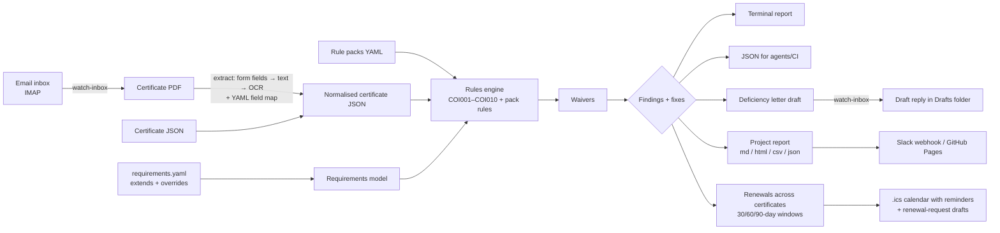

# Architecture — coi-lint

## 1. App flow



1. **Ingest** a certificate (JSON, or PDF via `extract.py` and a field map) into the `Certificate` model.
2. **Load** `requirements.yaml` (following `extends:`, applying per-insured overrides, loading rule packs).
3. **Check**: `check(cert, req, today)` + `packs.run(...)`, plus COI009/COI010 for unreadable/OCR'd PDFs.
4. **Apply waivers**, then **render**: text, JSON, letter, project report or renewals; exit code `0` compliant, `1` deficient, `2` input error.

No AI and no paid service anywhere in this flow. Open-ended questions go through the user's own AI via the SKILL.md.

## 2. System architecture

Single-process, offline Python CLI + importable library. No server, no database. The only network calls are opt-in and go to services the user controls: their own mailbox (IMAP, `watch-inbox`) and their own Slack webhook (`--slack-env`).

| Layer | Module | Responsibility |
|-------|--------|----------------|
| CLI | `cli.py` | argparse, file I/O, exit codes |
| Model | `models.py` | dataclasses + validation from dict |
| Rules | `rules.py` | deterministic checks, verdict |
| Output | `report.py` | text / JSON / letter renderers, fix lines, waived lines |
| Config | `config.py` | `extends:` inheritance, `insured_overrides`, pack loading |
| Packs | `packs.py` | declarative YAML rules (7 check types; never runs code) |
| Waivers | `waivers.py` | apply expiring waivers, waiver stats |
| Extract | `extract.py`, `fieldmaps/*.yaml` | PDF → certificate dict: form fields (pypdf) → text (pdfplumber) → OCR (Tesseract); size/page limits |
| Project | `project.py` | project summary → Markdown / HTML / CSV / JSON |
| Inbox | `inbox.py` | IMAP watcher → check → draft reply via IMAP APPEND (never sends) |
| Notify | `notify.py` | Slack incoming webhook (URL from an env var) |
| Integrity (P2) | `integrity.py` | PDF metadata and structure signals (planned) |
| Renewals | `renewals.py` | load many certificates, days left, 30/60/90-day windows |
| Export | `export.py` | `.ics` calendar with reminders, renewals JSON, renewal-request drafts per broker |

## 3. Folder and file structure

```
coi-lint/
├── src/coi_lint/
│   ├── __init__.py        # version
│   ├── __main__.py        # python -m coi_lint
│   ├── cli.py             # entry point
│   ├── models.py          # Certificate, Coverage, Requirements
│   ├── rules.py           # COI001–COI010 docs, checks, fixes, verdict, explain
│   ├── report.py          # text / json / letter
│   ├── config.py          # extends + overrides + packs
│   ├── packs.py           # YAML rule packs
│   ├── waivers.py         # waivers + stats
│   ├── extract.py         # PDF → certificate (forms / text / OCR)
│   ├── fieldmaps/         # field maps (YAML)
│   ├── project.py         # project report
│   ├── inbox.py           # IMAP watcher
│   ├── notify.py          # Slack webhook
│   ├── renewals.py        # renewal tracking across certificates
│   ├── export.py          # .ics calendar, renewals JSON, renewal letters
│   └── integrity.py       # (Phase 2)
├── examples/
│   ├── requirements.yaml  # sample project profile (fictional)
│   ├── cert_sample.json   # sample normalised certificate (fictional)
│   ├── requirements-strict.yaml  # extends + pack + override example
│   ├── waivers.yaml       # waiver examples (one deliberately expired)
│   ├── certs/             # two more fictional certificates
│   └── pdfs/              # the sample certificate as fillable, flat and scanned PDFs
├── packs/                 # example rule pack
├── schemas/               # JSON Schemas
├── scripts/               # make_sample_pdfs.py, precommit.sh
├── .github/workflows/ci.yml  action.yml  .pre-commit-hooks.yaml
├── docs/examples/         # GitHub Action + Pages workflow
├── tests/                 # pytest
├── docs/media/            # launch video, poster
├── PRD.md  Architecture.md  Rules.md  Phases.md  Design.md  Memory.md
├── pyproject.toml  LICENSE  README.md
```

## 4. Tech stack (and why)

| Choice | Why |
|--------|-----|
| Python 3.10+ | Best PDF tooling, the author's main language, easy for agents to call |
| PyYAML | Human-editable requirement profiles that non-developers can read |
| dataclasses (stdlib) | Zero-dependency typed model; swap to pydantic only if validation grows |
| argparse (stdlib) | No CLI framework dependency |
| pypdf | Reads AcroForm field values from fillable certificate PDFs without OCR |
| pdfplumber | Text extraction for flattened PDFs; renders pages for OCR |
| Tesseract + pytesseract (optional) | Free, offline OCR for scanned certificates |
| imaplib / email / urllib (stdlib) | Inbox watcher and Slack webhook with no extra dependencies |
| reportlab, jsonschema (dev only) | Generate the sample PDFs; validate examples against the schemas |
| pytest + ruff | Standard tests and lint |

No LLM in the core path: verdicts must be reproducible, and the project must stay free to run. Field maps are YAML, not AI. Open-ended help comes from the user's own AI through the SKILL.md.

## 5. Data model

```text
Certificate
  insured: str          producer: str        holder: str
  issued: date          description: str     source: str
  coverages: [Coverage]

Coverage
  kind: general_liability | auto | umbrella | workers_comp | <custom>
  policy_number: str    effective: date      expires: date
  limits: {name: int}   additional_insured: bool   waiver_of_subrogation: bool

Requirements
  name: str   holder: str   warn_days: int
  description_must_mention: [str]
  coverages: [CoverageRequirement{kind, min_limits, additional_insured, waiver_of_subrogation}]

Finding
  rule: COI001..COI008   severity: pass | warn | fail   coverage: str   message: str
```

### Rules

| Id | Check | Severity on miss |
|----|-------|------------------|
| COI001 | Certificate holder matches requester | fail |
| COI002 | Required coverage present | fail |
| COI003 | Policy not expired | fail |
| COI004 | Expires within `warn_days`, or not yet effective | warn |
| COI005 | Each limit ≥ minimum | fail |
| COI006 | Additional insured marked | fail |
| COI007 | Waiver of subrogation marked | fail |
| COI008 | Description of operations mentions required wording | fail |

## 6. Key APIs / integrations

- **CLI**: `coi-lint check <cert.json> --rules <req.yaml> [--format text|json|letter] [--today YYYY-MM-DD]`
- **Library**: `from coi_lint.rules import check, verdict`
- **JSON output** (stable contract for agents and CI):
  `{"insured", "requirements", "verdict", "findings": [{"rule","severity","coverage","message"}]}`
- **Renewals (v0.2.0)**: `coi-lint renewals <files/dirs> [--within 90] [--rules req.yaml] [--ics out.ics] [--format text|json|letter]`; exit `1` if anything shown has expired.
- **Phase 1**: `coi-lint extract <cert.pdf>` → JSON; `coi-lint sweep <dir>`.
- **Phase 3**: tool/MCP schema wrapping `check` so agent products can call it.
