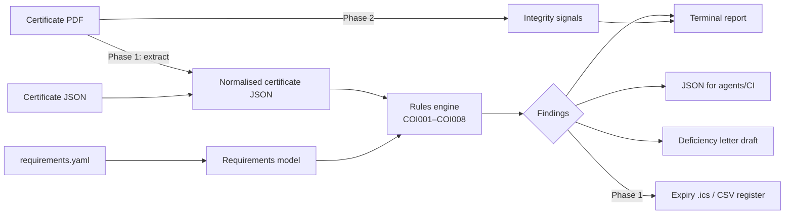

# Architecture — coi-lint

## 1. App flow



1. **Ingest** a certificate (JSON today; PDF in Phase 1) into the `Certificate` model.
2. **Load** a project's `requirements.yaml` into the `Requirements` model.
3. **Check**: pure function `check(cert, req, today) -> list[Finding]`.
4. **Render** findings as text, JSON or a letter; exit code `0` compliant, `1` deficient, `2` input error.

## 2. System architecture

Single-process, offline Python CLI + importable library. No server, no database, no network calls.

| Layer | Module | Responsibility |
|-------|--------|----------------|
| CLI | `cli.py` | argparse, file I/O, exit codes |
| Model | `models.py` | dataclasses + validation from dict |
| Rules | `rules.py` | deterministic checks, verdict |
| Output | `report.py` | text / JSON / letter renderers |
| Extract (P1) | `extract/forms.py`, `extract/text.py` | PDF form fields via pypdf; text fallback via pdfplumber + field map |
| Integrity (P2) | `integrity.py` | PDF metadata and structure signals |
| Export (P1) | `export.py` | `.ics` calendar, CSV register |

## 3. Folder and file structure

```
coi-lint/
├── src/coi_lint/
│   ├── __init__.py        # version
│   ├── __main__.py        # python -m coi_lint
│   ├── cli.py             # entry point
│   ├── models.py          # Certificate, Coverage, Requirements
│   ├── rules.py           # COI001–COI008 + verdict
│   ├── report.py          # text / json / letter
│   ├── extract/           # (Phase 1) PDF → Certificate
│   ├── export.py          # (Phase 1) ics / csv
│   └── integrity.py       # (Phase 2)
├── examples/
│   ├── requirements.yaml  # sample project profile (fictional)
│   └── cert_sample.json   # sample normalised certificate (fictional)
├── tests/                 # pytest
├── docs/media/            # launch video, poster
├── PRD.md  Architecture.md  Rules.md  Phases.md  Design.md  Memory.md
├── pyproject.toml  LICENSE  README.md
```

## 4. Tech stack (and why)

| Choice | Why |
|--------|-----|
| Python 3.10+ | Best PDF tooling, the author's main language, easy for agents to call |
| PyYAML | Human-editable requirement profiles that non-developers can read |
| dataclasses (stdlib) | Zero-dependency typed model; swap to pydantic only if validation grows |
| argparse (stdlib) | No CLI framework dependency |
| pypdf (Phase 1) | Reads AcroForm field values from fillable certificate PDFs without OCR |
| pdfplumber (Phase 1) | Positional text extraction for flattened PDFs |
| pytest + ruff | Standard tests and lint |

No LLM in the core path: verdicts must be reproducible. An optional AI-assisted field mapper may come later behind a flag, always followed by the same deterministic rules.

## 5. Data model

```text
Certificate
  insured: str          producer: str        holder: str
  issued: date          description: str     source: str
  coverages: [Coverage]

Coverage
  kind: general_liability | auto | umbrella | workers_comp | <custom>
  policy_number: str    effective: date      expires: date
  limits: {name: int}   additional_insured: bool   waiver_of_subrogation: bool

Requirements
  name: str   holder: str   warn_days: int
  description_must_mention: [str]
  coverages: [CoverageRequirement{kind, min_limits, additional_insured, waiver_of_subrogation}]

Finding
  rule: COI001..COI008   severity: pass | warn | fail   coverage: str   message: str
```

### Rules

| Id | Check | Severity on miss |
|----|-------|------------------|
| COI001 | Certificate holder matches requester | fail |
| COI002 | Required coverage present | fail |
| COI003 | Policy not expired | fail |
| COI004 | Expires within `warn_days`, or not yet effective | warn |
| COI005 | Each limit ≥ minimum | fail |
| COI006 | Additional insured marked | fail |
| COI007 | Waiver of subrogation marked | fail |
| COI008 | Description of operations mentions required wording | fail |

## 6. Key APIs / integrations

- **CLI**: `coi-lint check <cert.json> --rules <req.yaml> [--format text|json|letter] [--today YYYY-MM-DD]`
- **Library**: `from coi_lint.rules import check, verdict`
- **JSON output** (stable contract for agents and CI):
  `{"insured", "requirements", "verdict", "findings": [{"rule","severity","coverage","message"}]}`
- **Phase 1**: `coi-lint extract <cert.pdf>` → JSON; `coi-lint sweep <dir>`; `--ics out.ics`.
- **Phase 3**: tool/MCP schema wrapping `check` so agent products can call it.
