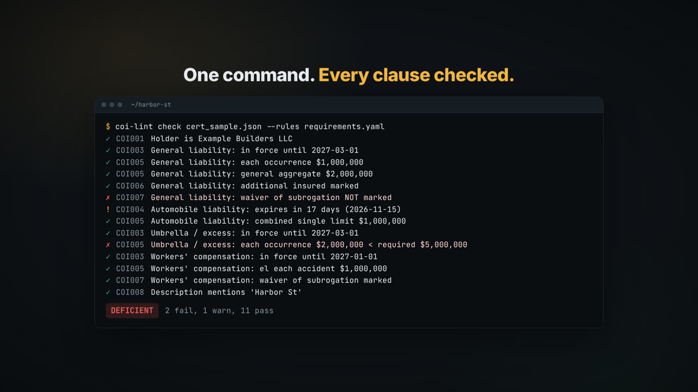

# coi-lint

**Linting for certificates of insurance.** Check a COI (PDF or JSON) against your project's requirements in one command: holder, limits, additional insured, waiver of subrogation, project wording and expiry. Every problem comes with the exact fix to ask the broker for, renewals land in your calendar, and new certificates can be checked the moment they hit your inbox.

**Free by design:** no AI in the verdict, no API keys, no server. Everything runs on your computer or in free GitHub Actions.


## Launch video

[](docs/media/coi-lint.mp4)

20-second launch video: [docs/media/coi-lint.mp4](docs/media/coi-lint.mp4) · social cut with a "rotate your phone" intro: [docs/media/social-coi-lint.mp4](docs/media/social-coi-lint.mp4). YouTube link coming soon.

## The problem

Before a subcontractor, vendor or tenant can start work, someone has to collect their certificate of insurance and check it by eye against the contract: right certificate holder? limits high enough? additional insured and waiver of subrogation marked? project named? anything expiring next week? It's mechanical work done from PDFs, tracked in spreadsheets and chased by email — and the same problems bounce between general contractors, insureds and their brokers.

coi-lint makes those checks **deterministic, explainable and instant**. It helps:

- **Compliance coordinators** at general contractors and property managers who check dozens of COIs per project.
- **Insurance agency CSRs** who issue certificates and want to catch problems before they bounce back.
- **Developers building insurance/construction agents** who need a reliable verdict their agent can call, not a guess.

The gaps it targets were observed in public descriptions of YC Summer/Fall 2026 companies working on agency servicing, construction compliance, claims and underwriting — see [PRD.md §2](PRD.md#2-gaps-this-project-addresses-observed-in-yc-summer-2026-and-fall-2026-companies). Independent student project; not affiliated with any company mentioned.

## Features

| | Feature | Since |
|---|---|---|
| ✅ | 8 built-in rules with stable ids (COI001–COI008) + COI009/COI010 for unreadable/OCR'd PDFs | v0.1 / v0.3 |
| ✅ | A concrete **fix suggestion** under every problem (`coi-lint explain <rule>` for the why) | v0.3 |
| ✅ | **Reads PDFs**: fillable form fields, the text layer, or **OCR** for scans (Tesseract), mapped with a YAML field map. Never guesses: unreadable fields are flagged | v0.3 |
| ✅ | **Waivers**: record a decision once ("not needed for this trade, until March") and it stops re-flagging; expired waivers are called out | v0.3 |
| ✅ | **Rule packs**: add your own checks in YAML, no Python (`packs/strict-gc-example.yaml`) | v0.3 |
| ✅ | **Config inheritance**: `extends:` a base requirements file, per-insured overrides | v0.3 |
| ✅ | **Project report** across every certificate: Markdown, HTML dashboard (light/dark), CSV register, JSON | v0.3 |
| ✅ | **Inbox watcher**: checks certificates as they arrive over IMAP and saves a reply to your Drafts (never sends) | v0.3 |
| ✅ | **GitHub Action** + Pages example, **pre-commit hook**, **JSON Schemas** for editor autocomplete, Slack webhook | v0.3 |
| ✅ | Renewal tracking (expired / 30 / 60 / 90 days), `.ics` reminders, renewal letters per broker | v0.2 |
| ✅ | Terminal / JSON / deficiency-letter output; CI-friendly exit codes (0 ok, 1 deficient, 2 bad input) | v0.1 |
| 🗺️ | Field maps for common real-world certificate layouts, integrity signals, PyPI | Planned |

## Check a certificate

A flat PDF (no form fields), with a waiver applied:

```console
$ coi-lint check examples/pdfs/northside-flat.pdf --rules examples/requirements.yaml --waivers examples/waivers.yaml
coi-lint · Northside Electric Co (fictional) → Harbor St Fit-out — subcontractor minimums

  ✓ COI001  Holder is Example Builders LLC
  ✓ COI003  General liability: in force until 2027-03-01
  ✓ COI005  General liability: each occurrence $1,000,000
  ✓ COI005  General liability: general aggregate $2,000,000
  ✓ COI006  General liability: additional insured marked
  ~ COI007  General liability: waiver of subrogation NOT marked
           waived: Waiver of subrogation on GL not required for electrical subcontract (contract clause 14.3, fictional) (until 2027-03-01, approved by J. Example)
  ! COI004  Automobile liability: expires in 11 days (2026-11-15)
           fix: Ask for the renewed automobile liability certificate before 2026-11-15.
  ✓ COI005  Automobile liability: combined single limit $1,000,000
  ✓ COI003  Umbrella / excess: in force until 2027-03-01
  ✗ COI005  Umbrella / excess: each occurrence $2,000,000 < required $5,000,000
           fix: Ask the broker to raise umbrella / excess each occurrence to at least $5,000,000 (or show an excess policy covering the $3,000,000 gap).
  ✓ COI003  Workers' compensation: in force until 2027-01-01
  ✓ COI005  Workers' compensation: el each accident $1,000,000
  ✓ COI007  Workers' compensation: waiver of subrogation marked
  ✓ COI008  Description mentions 'Harbor St'

DEFICIENT  (1 fail, 1 warn, 1 waived, 11 pass)
```

`--format letter` drafts the deficiency request (with each "Requested:" fix), `--format json` is for agents and CI, and `coi-lint explain COI007` explains any rule in plain English.

## Read PDFs

```bash
coi-lint extract certificate.pdf            # → normalised JSON (form fields → text → OCR)
coi-lint check certificate.pdf --rules requirements.yaml
```

The bundled field map ([`src/coi_lint/fieldmaps/sample.yaml`](src/coi_lint/fieldmaps/sample.yaml)) matches the fictional sample layout in `examples/pdfs/`. For your own certificates, copy it and map their form-field names or text labels (`--fieldmap mine.yaml`). Anything coi-lint can't read becomes a **COI009** failure instead of a guess; scanned certificates get a **COI010** "verify the values" warning, because OCR can misread characters.

## Track renewals

```console
$ coi-lint renewals examples/cert_sample.json examples/certs --ics renewals.ics
coi-lint renewals · 3 certificates · next 90 days (from 2026-11-04)

  ✗ expired 15d ago   2026-10-20  Harbor Plumbing Pty (fictional) · Workers' compensation · WC-0000102
  ! 11d left          2026-11-15  Northside Electric Co (fictional) · Automobile liability · AU-0000002
  · 46d left          2026-12-20  Harbor Plumbing Pty (fictional) · General liability · GL-0000101
  · 58d left          2027-01-01  Northside Electric Co (fictional) · Workers' compensation · WC-0000004
  · 82d left          2027-01-25  Coastal Steel Erectors (fictional) · General liability · GL-0000201
  · 82d left          2027-01-25  Coastal Steel Erectors (fictional) · Umbrella / excess · UM-0000202

1 expired, 1 within 30 days, 4 within 90 days
```

Import `renewals.ics` into Google Calendar, Outlook or Apple Calendar for reminders 90, 60 and 30 days before each expiry. `--format letter` drafts one renewal request per broker.

## Project report

```bash
coi-lint report certs/ --rules requirements.yaml --waivers waivers.yaml --format html --out report.html
```

Formats: `md` (Markdown, for wikis and PRs), `html` (a self-contained dashboard), `csv` (a register for Sheets/Excel), `json`. Add `--slack-env SLACK_WEBHOOK_URL` to post the headline to Slack through your own incoming webhook.

## Waivers, rule packs and config inheritance

- **Waivers** ([example](examples/waivers.yaml)): `insured`, `rule`, optional `coverage`, `reason`, `approved_by`, and a required `until` date. `coi-lint waivers waivers.yaml` shows which rules you waive most, a hint that a requirement may not fit every trade.
- **Rule packs** ([example](packs/strict-gc-example.yaml)): declarative checks (`limit_min`, `flag`, `valid_for_days`, `coverage_present`, `description_contains`, `holder_contains`, `policy_number_present`). Packs can't run code, so sharing them is safe.
- **`extends:`** ([example](examples/requirements-strict.yaml)): build a stricter profile on top of a base one, add packs, and override settings per insured.

## Automatic checks (free)

- **Inbox watcher**, like a code-review bot but for certificates. Runs on your computer:
  ```bash
  export COI_IMAP_PASSWORD="<an app password>"
  coi-lint watch-inbox --host imap.gmail.com --user you@example.com --password-env COI_IMAP_PASSWORD \
      --rules requirements.yaml --folder "COI" --drafts "[Gmail]/Drafts"
  ```
  For each new email with a PDF/JSON certificate it saves a reply to Drafts: the deficiency request, or a "received, compliant" note. It never sends, deletes or marks emails as read. Use `--once` with cron or Task Scheduler instead of leaving it running.
- **GitHub Action**: keep certificates in a repo and check them on every push. See [`docs/examples/coi-check-workflow.yml`](docs/examples/coi-check-workflow.yml) (writes the report into the job summary and publishes the HTML dashboard to GitHub Pages).
- **pre-commit**: `.pre-commit-hooks.yaml` checks changed `certs/*.json` before each commit.
- **Editor autocomplete**: JSON Schemas in [`schemas/`](schemas/) (VS Code picks them up via `.vscode/settings.json`).

## Use it with Claude (skill)

[`skills/coi-lint/SKILL.md`](skills/coi-lint/SKILL.md) teaches Claude (or any agent that reads skills) to run coi-lint, track renewals and explain findings. Download the skill zip from the [latest release](https://github.com/AagamS06/coi-lint/releases/latest) or copy the folder, then add it as a skill. This is the only "chat" part, and it runs on **your own** AI account, so the project itself stays free.

## Getting started

```bash
git clone https://github.com/AagamS06/coi-lint.git
cd coi-lint
python -m venv .venv && source .venv/bin/activate
pip install -e ".[dev,pdf]"          # add ,ocr and install Tesseract to read scanned certificates
pytest -q
coi-lint check examples/pdfs/northside-flat.pdf --rules examples/requirements.yaml
```

## Project structure

```
src/coi_lint/   cli · models · rules · packs · config · waivers · extract · report · project · renewals · export · inbox · notify
src/coi_lint/fieldmaps/   PDF field maps (YAML)
examples/       requirements*.yaml · waivers.yaml · cert_sample.json · certs/ · pdfs/  (all fictional)
packs/          example rule pack
schemas/        JSON Schemas for certificates, requirements, waivers, packs
scripts/        make_sample_pdfs.py · precommit.sh
tests/          38 tests (pytest)
skills/coi-lint/  SKILL.md for Claude and other agents
docs/           media (launch video, cover) · examples (GitHub workflow)
```

## Roadmap

Done: rules core (v0.1), renewals (v0.2), PDFs, waivers, packs, reports and automation (v0.3); see [CHANGELOG.md](CHANGELOG.md). Next: field maps for common real-world certificate layouts, a labelled accuracy set for extraction, PDF integrity signals, and PyPI. Full checklist in [Phases.md](Phases.md).

## Docs

| Doc | What's in it |
|-----|--------------|
| [PRD.md](PRD.md) | Problem, gaps (with sources), users, stories, features, metrics |
| [Architecture.md](Architecture.md) | Flow diagram, modules, data model, rules table, APIs |
| [Rules.md](Rules.md) | Contributor and AI-contributor rules, conventions, testing, security |
| [Phases.md](Phases.md) | Phased plan with checkboxes and exit criteria |
| [Design.md](Design.md) | Colours, themes, typography, components, accessibility |
| [Memory.md](Memory.md) | One-page handoff: decisions, status, next steps |
| [SKILL.md](skills/coi-lint/SKILL.md) | Agent skill: how to run coi-lint, track renewals and explain findings |
| [CHANGELOG.md](CHANGELOG.md) | What changed in each release |

## Contributing

Issues and PRs welcome, especially **rule packs**, **field maps** for real certificate layouts (fictional values only), and requirement templates. Read [Rules.md](Rules.md) first: every rule needs a test, use fictional data only, and never commit real certificates.

## Licence

[MIT](LICENSE) © 2026 Aagam Shah
